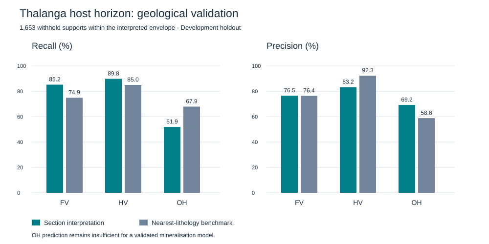

# Geological Architecture of the Thalanga Host Horizon

### A Section-Based Interpretation and Validation Study Using DeepRBF

**Technical case study · Ramadhani Ndonde, CPG · 11 November 2026**

This study examines a local, 300 m Thalanga corridor using explicit geological sections, paired contact surfaces and a consistent block representation. It demonstrates an auditable modelling workflow and reports its predictive limitations. It is not a Mineral Resource estimate or a completed reconstruction of the deposit.

## Technical assessment

Within the interpreted section envelope, the model correctly classified **78.3%** of withheld geological supports, compared with **77.7%** for nearest lithology on the same targets. This small aggregate difference does not establish a material predictive advantage.

The principal limitation is the OH host horizon: **51.9% recall** and **69.2% precision**. The interpretation misses a substantial proportion of observed OH supports. These results do not support a claim of reliable mineralisation reconstruction or production readiness.

## Data selection and interpretation

The corridor was selected by maximizing the minimum number of distinct training holes across six consecutive 50 m sections. It contains 287 distinct training holes, with at least 55 training holes per section. Grades and prediction scores were not used to select it.

Entire fold-0 holes were excluded before this area-selection step and contact interpretation. The dataset and earlier results have nevertheless been examined during development: this is a development holdout, not an independently blinded test.

The source formation codes FV, HV and OH are retained. The model represents the principal OH host horizon between the other two units. Individual sulphide lenses, intrusive bodies, fault displacement and economic ore boundaries are not resolved by this simplified interpretation.

Adjacent logged intervals supplied the FV–OH and HV–OH contacts. Logging gaps were not treated as observed contacts. The principal horizon was traced explicitly on training-only sections. Separate or displaced intersections remained in the audit rather than being connected automatically.

## Construction method

1. Record explicit main-horizon reference traces on six sections.
2. Project contacts to each section plane along the interpreted strike trend.
3. Summarize contact positions in 25 m elevation bands, first by hole and then across holes.
4. Require at least two distinct holes for each wall and reject crossed paired controls.
5. Loft the paired traces between sections using normalized section-height coordinates.
6. Assign 10 × 10 × 5 m blocks and generate shared boundaries from one categorical grid.
7. Reconcile exported mesh volumes with assigned block volumes.

The resulting local framework contains **50,380 geological blocks**. No density, grade estimates, resource tonnes or resource classifications were assigned in this case study.

Study boundaries reflect the selected area and vertical contact support; they are not geological pinch-outs. Median section controls do not honour every raw contact exactly. A section-projection correction was introduced after an initial unprojected development result; that earlier result is retained in the local audit.

## Validation

The targets are logged geological supports from withheld holes. Statistics count supports and are not length-weighted or volume-weighted. Nearest lithology uses the available training supports.

Of 2,473 withheld FV, HV and OH supports in the selected corridor, **1,653 (66.8%)** fall within the interpreted section envelope.

| Evaluation extent | Supports | Section model accuracy | Nearest-lithology accuracy |
|---|---:|---:|---:|
| Within interpreted envelope | 1,653 | 78.3% | 77.7% |
| Entire selected corridor | 2,473 | 52.4% | 77.6% |

Outside-envelope targets are unassigned by the section model and count as unsuccessful predictions in the whole-corridor assessment.

### Formation-specific performance within the envelope

| Unit | Observed supports | Section recall | Nearest recall | Section precision | Nearest precision |
|---|---:|---:|---:|---:|---:|
| FV | 446 | 85.2% | 74.9% | 76.5% | 76.4% |
| HV | 762 | 89.8% | 85.0% | 83.2% | 92.3% |
| OH | 445 | 51.9% | 67.9% | 69.2% | 58.8% |

Recall measures recovery of the observed unit; precision measures agreement among predictions of that unit. For OH, the section interpretation trades lower recall for higher precision. It correctly recovers 231 of 445 observed OH supports, misses 214, and assigns 103 other-unit supports to OH.

### Withheld contacts

| Contact | Withheld contacts | Within envelope | Median absolute northing residual | 95th percentile |
|---|---:|---:|---:|---:|
| FV–OH | 64 | 42 | 6.68 m | 36.44 m |
| HV–OH | 59 | 39 | 8.18 m | 31.51 m |

Residuals measure discrepancies along northing, not shortest orthogonal distances to the surfaces. They apply only to supported contacts. Coverage must be considered alongside residuals.

## Interpretation of the results

The demonstrated capabilities are reproducible contact extraction, explicit interpretation controls, paired-section construction, consistent block assignment, geometrical reconciliation and comparison with a simple benchmark.

The geological connection choices remain interpretation inputs, not proven automatic discoveries by the engine. The aggregate accuracy difference is small and has not been assessed with an independent uncertainty analysis. OH continuity remains insufficiently resolved for acceptance as a mineralisation or resource-estimation domain.

Further work must explain missed intersections using geological evidence and evaluate revised interpretations against newly reserved holes or independent observations. Finer blocks alone would not resolve the recorded contact and classification discrepancies.

## Publication scope and reproducibility

This public page contains the methodology and aggregate validation results. The raw drilling tables, drillhole identifiers, source-coordinate models, spatial figures, meshes and private working archive are not distributed here.

The original distribution source and reuse terms of the supplied drilling files have not been independently established in this workflow. This publication therefore does not grant access to or redistribution rights over those files.

Aggregate metrics are available in [validation_metrics.csv](validation_metrics.csv). Full local reproduction requires the original inputs, interpretation controls and DeepRBF workflow environment. This public summary is not a standalone reproduction package.

**This is a technical documentation publication, not a new software release or a professional resource-certification statement.**
